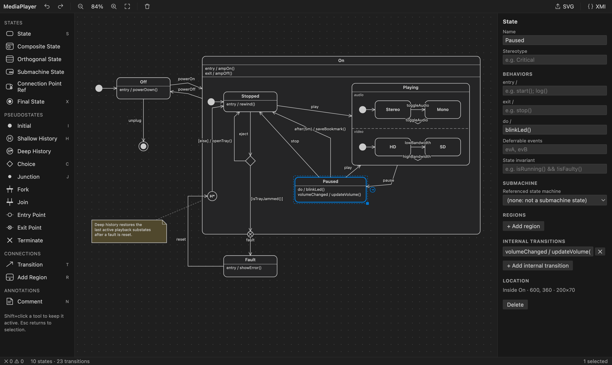
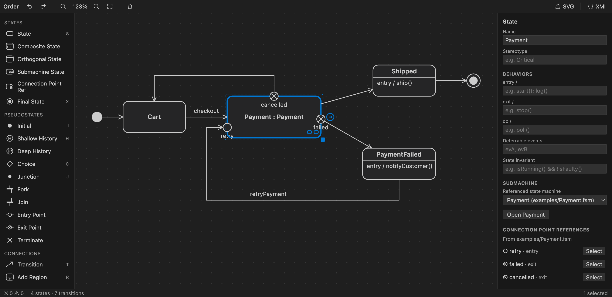
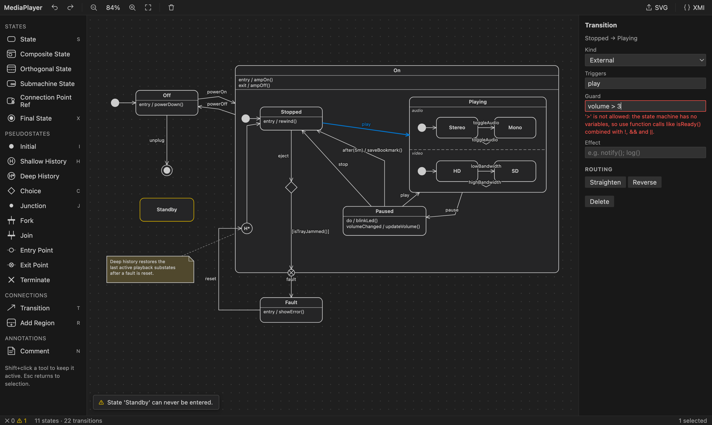

# FSM Editor — UML State Machines & Code Generation for VS Code

[](https://marketplace.visualstudio.com/items?itemName=VinceGoSoftware.fsm-editor)

A visual editor and code generator for UML 2.5.1 state machines. Draw a machine in any `*.fsm` file, with a toolbox, a properties panel, live validation and SVG and PNG export, then generate its source code from templates, in VS Code or with the `fsm` command-line tool. A machine is two JSON files: `Name.fsm`, the model, readable and editable by hand (elements are identified by their names), and `Name.fsm.layout` beside it, the drawing. Changes to a machine can be reviewed and merged as diagrams, side by side.

It also works in VS Code for the Web: open a repository on [github.dev](https://github.dev) (press `.` on any GitHub repository) or a folder on [vscode.dev](https://vscode.dev), install FSM Editor from the Extensions view, and open a `.fsm` file.



## Code generation

*Generate Code…* (the **Code** toolbar button, or the Explorer context menu of a `.fsm` file) turns a machine into source code with a [Jinja](https://jinja.palletsprojects.com/) template, in desktop VS Code and in VS Code for the Web alike. One template can write several files per machine. Two templates are bundled:

- **`ts`**: a dependency-free TypeScript class with run-to-completion semantics, plus an actions interface for you to implement.
- **`sml`**: C++17 with [Boost.SML](https://github.com/boost-ext/sml): a `.h`/`.cpp` pair per machine holding its Boost.SML transition tables, an events interface (what you send the machine) and an actions interface (what it needs from you: behaviors, conditions, timers). Boost.SML has no transitions across composite states, entry/exit points, forks, joins or UML history: the generated code works around them with a warning for each, and refuses what it cannot express.

The code generator is [fsm-cli](https://github.com/vincedupuis/fsm-cli), which the extension runs as WebAssembly. It is also the `fsm` command-line tool, a single executable for Windows, macOS and Linux, for builds and CI:

```sh
fsm write "models/**/*.fsm" --template ts --out src/generated
fsm write "models/**/*.fsm" --template sml --out src/generated
```

See **[docs/CODEGEN.md](docs/CODEGEN.md)** for the command line, the bundled templates, writing templates for other languages, and the code model they receive.

## Trace Player

*Open Trace…* (also in the **Trace** button of the diagram's toolbar, which shows the panel) replays logs of your running state machines on their diagrams: the active states, the transitions taken by the current step, and the branches chosen at choices and junctions. Open several logs at once for concurrent machines: the **Trace Player** panel merges them on one timeline by their timestamps. Step through the records, drag the timeline, play them back at a chosen speed, or turn on **Live** to follow the files as your application writes them (playing to the end turns it on; desktop only: the web edition reads the files once).

A submachine state shows as active in its parent's diagram, and the states inside it light up in the submachine's own diagram when that file is open. When a machine runs several times at once (several logs, or a submachine used by several states), each instance has its own color in the diagram, shown in the status bar and in the panel's records.

The generated code reports what it does through an `onTrace` hook (see [CODEGEN.md](docs/CODEGEN.md#tracing)); have it write lines in the built-in format, after any prefix your logger adds:

```
2026-11-11T10:02:03.120Z INFO fsm Order event checkout checkout
2026-11-11T10:02:03.121Z INFO fsm Order transition Cart#1 Cart -> Payment (checkout)
2026-11-11T10:02:03.121Z INFO fsm Order.Payment enter Authorizing Authorizing
```

That is `fsm <machine> <kind> <id> <name>`, with `kind` one of `event`, `enter`, `exit`, `transition`, and an optional ISO 8601 time (or time of day) earlier on the line. `examples/demo.log` replays the three examples. Other logs are read with formats of the `fsmEditor.trace.formats` setting: regular expressions whose named groups give the record, for example:

```json
"fsmEditor.trace.formats": [
  {
    "name": "My service",
    "time": "^(?<time>\\S+)",
    "rules": [
      { "kind": "event", "match": "received (?<name>\\w+)" },
      { "kind": "enter", "match": "entering (?<name>[\\w:]+)" },
      { "kind": "transition", "match": "(?<source>\\w+) -> (?<target>\\w+)" }
    ]
  }
]
```

Groups: `time`, `machine` (the machine's name, then the submachine states leading to a submachine: `Order.Payment`), `id` (the element's id, derived from the names: `Off`, `Paused#2`, `On.fault`; see the file format), `name` (a name or a path of names such as `On::Playing`), `source` and `target` (a transition by its ends, through any pseudostates between them), and `kind` when the rule doesn't give one. When the lines of a log name no machine (and its format gives none), the Trace Player asks which machine they are about; click the machine next to the log in the panel to change it. A log with transitions but no `enter` lines still shows the active states, from the transitions' targets.

## UML support

The editor covers UML 2.5.1 state machines: composite, orthogonal and submachine states, all pseudostates, connection point references, entry/exit/do behaviors, deferrable events, the external, local and internal transition kinds, time triggers, and protocol state machines. A validator checks the well-formedness rules as you edit.

Behaviors and conditions are argument-less function calls (`rewind(); showTime()`, `hasDisc() && !isJammed()`), and triggers are event names or `after(2s)`.

Submachine states reuse another state machine file. They're entered and left through connection point references bound to that machine's entry and exit points:



Text that breaks the rules is refused as you type, and the validator flags problems on the diagram and in VS Code's Problems panel:



See **[docs/UML-CONFORMANCE.md](docs/UML-CONFORMANCE.md)** for:
- the supported features and the text syntax;
- how to use submachines and connection point references;
- how the model and layout are stored, and how files of earlier versions (XMI) are converted;
- where and why the tool deviates from UML 2.5.1;
- every validation rule;
- what the SVG and PNG exports contain.

## Using the editor

- **Add elements**: click a toolbox item and then the canvas, or drag it onto the canvas. Drop an element entirely inside a region to nest it. A composite state moves by its title bar: dragging inside its regions draws a selection band. Double-click empty canvas to add a state.
- **Nesting**: an element inside a composite state stays in its region. Dragging or resizing it past the region's border grows the region, its state and the states around it, and moving back during the same drag shrinks them again. Right-click it and choose *Leave Parent* to move it up one level, to the region holding its state. Overlapping elements get a warning on the diagram.
- **Transitions**: select an element and drag its ⊕ handle to the target, or use the Transition tool (T). Drawing from a comment attaches the comment instead. Drag an end of a selected transition onto another element to move its source or target there.
- **Labels**: double-click a name or transition label to edit it in place. The transition syntax is `event, after(2s) [isReady() && !isBusy()] / doIt(); log()`.
- **Routing**: double-click a transition to add a bend point, double-click a bend point to remove it, and drag labels to move them.
- **Regions**: use the Add Region tool (R) or the properties panel. Each region has its own size: drag the line between two regions to resize the one before it. Resizing the state on the side of its first or last region resizes that region.
- **Groups**: select elements in the same region, right-click one of them and choose *Group*, or press G. Selecting a member of a group shows a dotted rectangle around the group, and dragging it moves the whole group, into a composite state's region as well. *Ungroup*, or G again, dissolves the groups of the selected elements. A click selects a single member, for its properties, Delete or Copy. Groups are flat: grouping elements of different groups merges them into one.
- **Extract to Submachine**: select elements of one region, or one composite state, right-click one of them and choose *Extract to Submachine…*. They move to a new state machine file next to this one, and a submachine state referencing it takes their place, with connection points for the transitions that crossed the boundary. See the [conformance doc](docs/UML-CONFORMANCE.md#submachines-and-connection-point-references).
- **Align**: select elements, right-click one of them and choose *Align Horizontally* (on its horizontal center line) or *Align Vertically* (on its vertical one). Points on a state's border don't align. The elements keep their regions: a composite state grows when its region no longer holds them. An element that is the only selected member of its group brings the whole group along; select several members of a group, or the anchor's group, to align them within it.
- **Colors**: in the properties panel, *Color* colors the selected element, and the swatch beside an entry, exit, do, deferrable events, invariant, trigger, guard or action field colors just that text. A composite state has a *Title color* (its outline, text and header) and a *Background color* (its regions) instead. *Default* removes the color.
- **View**: right-drag, middle-drag or Space+drag pans, the mouse wheel zooms, two fingers on a trackpad pan and pinching zooms, F fits the diagram.
- **Properties window**: right-click an element, or empty canvas for the state machine, and choose *Properties…* (or Alt+click or middle-click an element) to edit its properties in a window next to the pointer, without the properties panel. It closes with Esc or a click outside it. *Delete* in the same menu deletes the selection.
- **Panels**: ✕ closes the toolbox or the properties panel, and the two toggles at the right of the toolbar show and hide them, in every diagram.
- **Editing**: Delete removes the selection. Ctrl/Cmd+C/X/V copies, cuts and pastes, including between diagrams. Ctrl/Cmd+D duplicates. *Cut*, *Copy* and *Paste* are also in the context menu, which pastes where you right-clicked. Undo and redo are VS Code's own, over the model and its layout: a move is undone like any other change, and saving writes both files.
- **Shortcuts**: S state, X final, I initial, H history, C choice, J junction, N comment, T transition, R region, G group/ungroup, V/Esc select. Shift+click a tool to keep it active.

Commands (Command Palette → "FSM"): *New State Machine*, *New Untitled State Machine*, *Generate Code…*, *Open Trace…*, *Export as SVG*, *Export as PNG*, *Open as Text*, *Open in FSM Editor*, *Compare as Diagrams*. *New Untitled State Machine* is also *State Machine* in **File › New File…**.

## Files

A machine `Order` is `Order.fsm`, the model, and `Order.fsm.layout` beside it, the drawing. Both are JSON, and the diagram edits them together: moving an element changes only the layout file, and undo, save and revert cover both. Renaming or moving `Order.fsm` in VS Code (the Explorer, or a refactoring) takes `Order.fsm.layout` with it. The model file is meant to be read, reviewed and edited by hand:

```json
{
  "version": 1,
  "name": "Order",
  "type": "behavioral",
  "initial": { "target": "Cart" },
  "elements": [
    {
      "name": "Cart",
      "type": "state",
      "transitions": [
        { "type": "external", "trigger": "checkout", "target": "Payment" }
      ]
    },
    …
```

Elements are identified by their names, which are unique in the machine and have no spaces. Elements you don't name (choices, final states, comments…) get a generated name ending with `*`, which the diagram doesn't show. *Open as Text* opens the model file in the text editor, checked and completed against the format's JSON Schema; the diagram follows the text (when the diagram has unsaved changes, which the file doesn't hold yet, it offers to save them first). A file that isn't valid JSON, or has the wrong shape, shows its problems with their lines instead of the diagram. A model and a layout file that disagree (a hand edit, a merge, a lost layout file) are reconciled: elements without a place are placed automatically, and nothing in the model is ever dropped. The format is described in [fsm-cli's README](https://github.com/vincedupuis/fsm-cli#the-fsm-file-format) and in [docs/UML-CONFORMANCE.md](docs/UML-CONFORMANCE.md#file-format).

Files of earlier versions (XMI 2.5.1 with UML DI) still open, unchanged (opening one doesn't mark it as changed, so auto save leaves it alone): saving one writes the new format, converting the files linked to it by submachine states at the same time, and says what was renamed or left out.

## Diagram diff and merge

**Diff.** VS Code shows the changes of a `.fsm` file (Source Control, the timeline, *Compare With…*) as a text diff of the JSON. **FSM: Compare as Diagrams** (the diagram button in the diff's title bar, or the context menu of a changed `.fsm` file in Source Control) opens the two versions as diagrams side by side, the older one on the left, read-only, the newer one on the right, editable when it is your working copy. Added elements are marked on the right, removed ones on the left, changed ones on both; select a changed element to see what changed in it (guard, action, target…). ◀ ▶ step through the changes, and the two diagrams scroll and zoom together. Changes of the drawing alone (positions, routes, colors) aren't marked unless you tick *Show layout changes*. Elements are matched by name, transitions by source, trigger and target: a renamed state shows as one removed and one added. An older version without its layout file is drawn where the newer one places the same elements. An old-format file compares with its converted version.

**Merge.** A `.fsm` file with merge conflicts (after a merge, rebase or cherry-pick) opens as three diagrams: the result (the file, starting as the current side, and marked as changed only once you choose), and the **Incoming** and **Current** sides beside it, read-only. The conflicts, the differences between the two sides, are listed and marked: take each from incoming or keep it current, or all at once, then **Complete Merge**, which saves both files without markers and marks them resolved in Git. When Git gives the common version, the changes each side made, which Git merged by itself, are marked lightly. When a side of the conflicts isn't a valid machine file, the diagram shows why, with a button to VS Code's text merge editor. A conflict in the layout file alone opens the diagram with the current positions; saving writes a clean layout file.

## Development

```sh
npm install
npm run build:common # builds ../fsm-editor-common as WebAssembly into common/, with fsm-cli's templates
npm run compile      # type-check, then bundle for desktop and web; or: npm run watch
npm run test:unit    # unit and code generation tests (Node; compiles the C++ of the sml template when a C++ compiler is found)
npm run test:web     # smoke test in VS Code for the Web (Chromium)
```

The extension needs `common/common.wasm` ([fsm-editor-common](https://github.com/vincedupuis/fsm-editor-common): reading, writing, converting, validating, comparing and merging machines, and code generation), `common/templates/*.jinja` and `common/schemas`, which are not in the repository. `npm run build:common` builds them from checkouts of fsm-editor-common and [fsm-cli](https://github.com/vincedupuis/fsm-cli) next to this one (`../fsm-editor-common`, `../fsm-cli`), and needs [Rust](https://rustup.rs) with the WebAssembly target: `rustup target add wasm32-unknown-unknown`. It uses `cargo` from the PATH, or else from `~/.cargo/bin`. Run it again after changing either. The release workflow downloads them from the fsm-editor-common release named by `FSM_COMMON_VERSION` in `.github/workflows/release.yml` instead.

Press F5 in VS Code to launch an Extension Development Host with the `examples` folder open, then open `examples/MediaPlayer.fsm`, or `examples/Order.fsm` for a submachine with connection point references (it uses `examples/Payment.fsm`).

Package with `npm run package`, which produces a `.vsix` file.

### Layout

- `src/extension.ts`: commands and registration (bundled by `esbuild.mjs` into `out/extension.js` for desktop and `out/web/extension.js` for the web)
- `src/fsmEditorProvider.ts`: the custom editor and its two-file document (edits, undo, save, revert, backups); publishes diagnostics
- `src/model.ts`: the in-memory model the diagram editor works on
- `src/common.ts`: the client of fsm-editor-common's module: reading and writing the `.fsm` and `.fsm.layout` files, converting files of earlier versions (XMI), validation, the grammar's checks, comparing and merging, code generation
- `src/sessions.ts`: the diff and merge panes
- `media/editor.js`, `media/editor.css`: the diagram editor webview (no dependencies)
- `src/util.ts`: path and text helpers that work in both the desktop and web extension hosts
- `src/codegenCommand.ts`: the *Generate Code…* command
- `common/`: fsm-editor-common's module (`common.wasm`), the bundled templates (`templates/*.jinja`), the files' JSON Schemas (`schemas/`) and the module's interface cases (`api-cases/`), from `npm run build:common` (not in the repository)
- `scripts/build-common.mjs`: builds them from `../fsm-editor-common` and `../fsm-cli`
- `test/unit/`: unit and code generation tests run by `npm run test:unit`
- `test/web/`: browser smoke test run by `npm run test:web`
- `docs/UML-CONFORMANCE.md`: supported UML features, deviations, validation rules and export mappings
- `docs/CODEGEN.md`: code generation, templates and the code model
